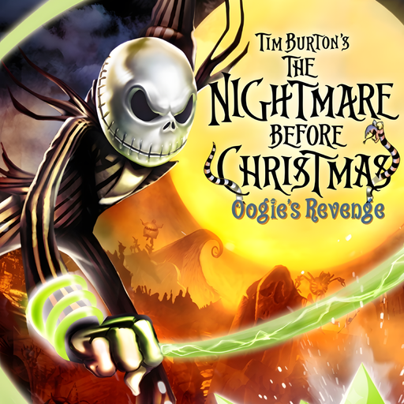

# The Nightmare Before Christmas PS5 Port

<p align="center">
  
</p>

<p align="center">
  
</p>

An unofficial native PS5 homebrew port of **The Nightmare Before Christmas: Oogie's Revenge**. It builds on [Pallypots' Project Oogie](https://github.com/Pallypots/ProjectOogie), which recompiles the original Xbox version with [XboxRecomp](https://github.com/sp00nznet/xboxrecomp).

**v1.0 is a source release.** Build the PS5 executable locally using your own supported USA Xbox disc image. The release includes neutral launcher art generated during the build. Game files, the ISO, and the locally built executable are supplied by the player.

## What's included

- A controller-operated launcher with **Prepare Game**, **Play Game**, and **Settings**.
- On-console ISO extraction with a progress bar.
- Widescreen gameplay, menus, and cutscenes. Menus and prerecorded cutscenes stretch to fill the display in widescreen mode.
- Internal render resolution options from 480p to 2160p, enhanced texture filtering, and gameplay brightness.
- Separate music, dialogue, and effects volume controls, DualSense rumble, and face button remapping.

## 1. Prepare the build tools

Use Linux or WSL2 Ubuntu. You'll need Git, Python 3, CMake, Ninja, glslangValidator, Python Capstone and Pillow (10.1 or newer), and a PS5 homebrew toolchain with the Prospero compiler and CMake files. The build expects `~/ps5-sdk` and `~/PS5_Vulkan` by default. You can override those paths with `PS5_SDK` and `PS5_VULKAN_DIR`.

Set up [PS5_Vulkan](https://github.com/mihawk-99/PS5_Vulkan) using its RADV release and native tooling instructions. The development build used revision `f410e67a0241b3e8edcdbcd2a9b285dfc4a412ed`. Before continuing, make sure the Vulkan checkout has `build/host/ps5-native-tool`, `runtime/libc.prx`, and `.deps/native/radv-release/lib/libvulkan_radeon.ps5.a`. The Vulkan backend is needed by the launcher.

From this repository's root, fetch the source dependencies:

```bash
git clone https://github.com/Pallypots/ProjectOogie.git upstream
git -C upstream checkout --detach d166eb5e26e477b0a516f48f3112765a734fac65
git clone https://github.com/KongaTime/The-Darkness-Recomp-PS5.git darkness-ps5
git -C darkness-ps5 checkout --detach 91181d47b50b7f72aa3aae4c0cc308225dfc7340
mkdir -p ~/oogie-work/game
git clone https://github.com/sp00nznet/xboxrecomp.git ~/oogie-work/xboxrecomp
git -C ~/oogie-work/xboxrecomp checkout --detach eb0aa1d5fcb1ca34cdb6470fcfa471d87f431d73
```

The Darkness checkout supplies shared PS5 compatibility headers and the portable SHA-256 helper used to verify the disc. The XboxRecomp checkout supplies the compiler and runtime. Follow each dependency's own build and license instructions.

## 2. Build with your disc

Use the **USA original Xbox** edition (title ID `42560004`). The port checks the exact supported `default.xbe`.

```bash
python3 upstream/tools/xiso_tool.py extract "/path/to/your/disc.iso" default.xbe ~/oogie-work/game/default.xbe
sha256sum ~/oogie-work/game/default.xbe
bash tools/lift.sh
OOGIE_TUNE_GUEST=ON OOGIE_PASS_CONTEXT=ON bash ps5/tools/build.sh
```

The expected executable SHA-256 is `9a8319c7b1cb5ee29781bf641a0cf549c221fdc57effb8f72085608019f41548`. Use the original matching disc build if it differs. The compiler writes generated code to `~/oogie-work/gen`. The build writes the install folder to `ps5/build/dist/PPSA90030/`.

## 3. Install and prepare the game on PS5

Use a PS5 setup that already supports launching native homebrew from `/data/homebrew` and has a working FTP service. From the repository root, run this with your console's LAN address and FTP port:

```bash
python3 ps5/tools/install.py --host PS5_IP --port 2121 --verify
```

The installer copies the locally built title and creates its writable game and save parent folders. You can use `--plan` to inspect the transfer first.

| File or directory | Where it goes |
| --- | --- |
| Locally built title | Copy the contents of `ps5/build/dist/PPSA90030/` into `/data/homebrew/PPSA90030/`. Keep the included files and subdirectories together. |
| Your disc image | Copy it to `/data/homebrew/PPSA90030/Oogie.iso` over FTP. |
| USB alternative | Put `Oogie.iso` at the root of a PS5-readable drive with support for files over 4 GB. The launcher checks `/mnt/usb0` and `/mnt/usb1`. USB detection is still unverified on hardware. |
| Prepared game files | The launcher writes them to `/data/oogie-ps5/game/`. |
| Saves | The game uses `/data/oogie-ps5/saves/`. |
| Optional config | `/data/homebrew/PPSA90030/settings.ini`. The launcher saves its settings under `/data/oogie-ps5/`. |

Register or refresh the title in your homebrew launcher. The tile is listed as **The Nightmare Before Christmas: Oogie's Revenge**. Open it, choose **Prepare Game**, and wait for the progress bar to finish. This is a multi-gigabyte copy and may take a while. Once the button switches to **Play Game**, select it to start the game. Use the PS button and the PS5's **Close Game** option when you're done.

An alternative for existing setups is to extract the disc on PC using `bash tools/extract-disc.sh "/path/to/your/disc.iso" ~/oogie-work/dump`, then add `--dump ~/oogie-work/dump` to the install command. This copies the extracted files to `/data/homebrew/PPSA90030/Oogie/` and opens directly to **Play Game**.

## Settings and troubleshooting

- Use **Left/Right** in **Settings**, then choose **Save and Back** before selecting **Play Game**.
- If you want widescreen output, put `aspect = 1` under `[Display]` in `settings.ini` and reopen the title. Use `aspect = 0` for 4:3. Internal render resolution is separate from TV output resolution.
- If Prepare Game cannot find your ISO, confirm the filename is exactly `Oogie.iso` and the transfer completed.
- If preparation fails, check the disc version and free console storage. Leave space for both the ISO and about **3.5 GB** of extracted files if the ISO is on the console.
- To fetch boot logs, run `python3 ps5/tools/install.py --host PS5_IP --port 2121 --pull-logs`.

## Verified on PS5

The original USA ISO was transferred over FTP and prepared on the console. The player confirmed the game launched from the prepared files, saving and loading worked, and Chapters 1–3 played through to Chapter 4 without reported gameplay issues. The rest of the campaign has not been fully playtested.

## Credits

Thanks to Pallypots for Project Oogie, sp00nznet for XboxRecomp, the PS5_Vulkan contributors, and the developers whose work provided the PS5 host layer and portable hashing helper. The original game and characters belong to their respective owners. This is an unofficial fan project.
